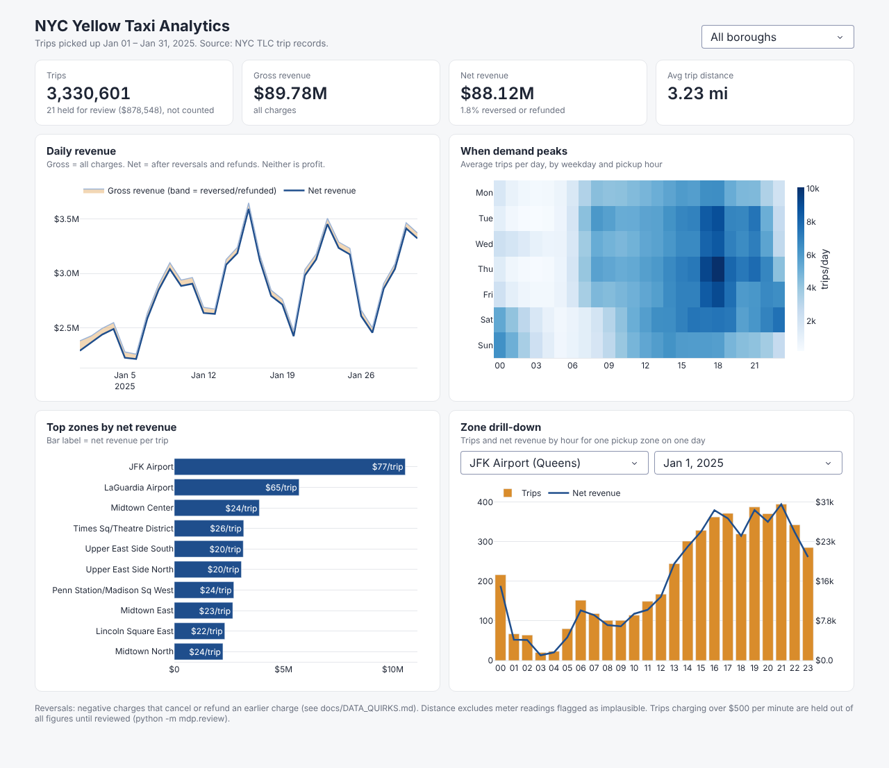

# Mobility Data Platform

A fault-tolerant, metadata-driven ingestion platform for NYC mobility data (TLC trips, NOAA weather).

> **Status:** ingestion and the star-schema warehouse are done, tested, and run on real data:
> 3.47M January 2025 trips in 5.5 s, crash-and-rerun output byte-identical to a clean run, and dashboard
> queries up to 51× faster from a pre-aggregated rollup, served by a Plotly Dash dashboard with a human review
> queue for anomalous fares. AWS deployment comes next.



## What it guarantees

Each guarantee has a test that fails if it breaks. `tests/test_pipeline.py` crashes runs on purpose
at every step and checks that the rerun matches a clean run exactly.

| Guarantee | How | Proof |
|---|---|---|
| Rerunning the same file is a no-op | batch id = hash(source, month, file checksum); committed batches are skipped | `test_rerun_same_file_is_noop` |
| A crash at any step, then a rerun, yields exactly the clean-run output | publish to staging → swap → commit record written **last** | `test_crash_then_rerun_matches_clean_run` (3 fault points) |
| Raw input is immutable | stored once per checksum, never overwritten | `test_raw_is_immutable_and_kept_per_version` |
| A corrected file replaces its month instead of appending | partition-scoped overwrite | `test_corrected_file_replaces_partition_not_appends` |
| Bad data never publishes, and the last good month survives | schema contract + batch gates before publish | `test_gate_breach_publishes_nothing_and_keeps_prior` |
| No row disappears silently | rejected rows go to quarantine with every rule they broke | `test_clean_run_commits` |
| Reversals are never deduplicated away | key includes `total_amount`, so +X/−X pairs stay distinct | `test_charge_and_reversal_are_not_duplicates` |
| Late-arriving trips land in their real month, never twice | held in `late/`, merged by the warehouse with an anti-join on the trip key | `test_late_rows_join_their_real_month`, `test_late_row_already_in_its_month_is_not_double_counted` |
| The warehouse only ever shows committed data | loads read the manifest; each month reloads in one transaction | `test_uncommitted_month_is_never_loaded`, `test_late_rows_from_crashed_run_are_ignored` |
| Anomalous fares never reach the numbers unreviewed | `suspect_fare` trips are kept but held out of the rollup until approved in a review file | `test_suspect_trip_is_held_out_of_rollup_but_kept_in_fact`, `test_approved_trip_counts_after_rebuild` |
| Changing a rule reprocesses months already loaded | the batch id includes a fingerprint of the contract's rules | `test_rule_change_reprocesses_a_loaded_month` |
| Same input, same output, regardless of row order | deterministic dedupe and sorted publication | `test_dedupe_is_order_independent` |

## What the real data taught it

Profiling January 2025 overturned the obvious rules. 4% of fares are negative, but they're reversals and
Flex Fare adjustments, not errors. The "duplicate" trips were charge/reversal pairs that net to $0, so
deduplicating them would have corrupted revenue. The contract now **rejects** only rows whose core facts are
unusable (145 of 3.47M), routes 22 **late-arriving** trips to their real month, **holds** 21 anomalous fares for
human review (one was $863,372 for a 1.6-mile ride), and **flags** real-but-unusual records instead. Evidence for every decision:
[`docs/DATA_QUIRKS.md`](docs/DATA_QUIRKS.md).

## How a source is defined

Sources are onboarded through a YAML data contract instead of new code. See
[`configs/sources/tlc_yellow.yaml`](configs/sources/tlc_yellow.yaml): canonical names and types, required
columns, candidate key, monthly partition, SQL quality rules, and batch gates.

Each source defines **reject rules** (row quarantined), **flags** (row kept, boolean column added), and **batch
gates** (whole run fails, nothing published).

Schema drift policy: a missing required column or an incompatible type rejects the batch. A missing optional
column is filled with nulls. Unknown new columns are allowed, recorded in the run manifest, and not loaded.

## Quickstart

```bash
python -m venv .venv && source .venv/bin/activate      # Windows: .venv\Scripts\activate
pip install -e ".[dev,dashboard]"
pytest                                                  # 97 tests, no download needed

python scripts/download.py 2025-01
python -m mdp.profile data/raw/yellow_tripdata_2025-01.parquet 2025-01 --out docs/profile_2025-01.md
python -m mdp.ingest --contract configs/sources/tlc_yellow.yaml \
    --file data/raw/yellow_tripdata_2025-01.parquet --month 2025-01 --lake lake/
python -m mdp.warehouse --lake lake/ --db warehouse.duckdb      # star schema + rollup
python benchmarks/query_tuning.py                              # writes docs/QUERY_TUNING.md
python -m mdp.dashboard --db warehouse.duckdb                  # http://127.0.0.1:8050
python -m mdp.review                                           # list trips held for review
```

## Review queue

Trips charging more than $500 per minute are kept in `fact_trip` but **held** out of every revenue figure and
trip count until a person decides. A z-score was tried first and rejected: the $863K outlier inflated the standard
deviation enough to hide itself (masking). Details in [DATA_QUIRKS.md](docs/DATA_QUIRKS.md).

```bash
python -m mdp.review --export review_todo.csv   # fill decision = approved | rejected, reviewer, note
python -m mdp.review --apply review_todo.csv    # appends decisions to configs/reviews/tlc_yellow.csv
python -m mdp.warehouse                         # review file changed -> rollup rebuilt
```

## Dashboard

`python -m mdp.dashboard` serves four views, each reading the rollup: KPIs, daily gross vs net revenue (the shaded
band is money reversed or refunded), a weekday × hour demand heatmap, top zones by net revenue per trip, and a
zone/day drill-down. Everything filters by borough.

Revenue appears twice by design: **gross** (all charges) and **net** (after reversals and refunds). Neither is
profit; the data has no costs. What it shows for January 2025: JFK is only the 4th busiest pickup zone but earns
the most, $77 net per trip against $24 for Midtown Center. Queens still peaks on Jan 20 after the bad fare is held:
about 14,000 trips against a normal ~9,000. Jan 20 was both MLK Day and Inauguration Day; the cause is not confirmed.

## Warehouse

A star schema built only from committed partitions: `fact_trip` (stored sorted by date and pickup zone),
dimensions for date, location, vendor, payment type and rate code (codes from the TLC data dictionary), and
`agg_daily_zone_hour`, a rollup 36× smaller than the fact table. Each month loads in one transaction, so the
fact table and rollup can never disagree; revenue matches to the cent.

| Dashboard query | Raw Parquet | Star schema | Rollup |
|---|---:|---:|---:|
| Daily revenue and trips | 159.0 ms | 61.9 ms | 3.1 ms |
| Weekday × hour demand by borough | 220.2 ms | 95.0 ms | 7.1 ms |
| One zone, one day, by hour | 21.2 ms | 4.5 ms | 1.8 ms |

Raw and star queries apply the review rule on every query; the rollup applies it once, at load time.

Rollups win when a query scans the whole month; sort order wins when it filters. Sorting alone made the
drill-down 5× faster than the same data shuffled. Details: [QUERY_TUNING.md](docs/QUERY_TUNING.md).

## Layout

```
configs/sources/        data contracts, one per source
src/mdp/profile.py      data-quality profiler (SQL checks via DuckDB)
src/mdp/config.py       contract loading and validation
src/mdp/contracts.py    schema checks and conformance
src/mdp/quality.py      row rules, quarantine, deterministic dedupe
src/mdp/manifest.py     run history and commit records
src/mdp/pipeline.py     the ingestion run: land → check → quarantine → gate → publish → commit
src/mdp/ingest.py       command-line entry point
src/mdp/warehouse.py    star schema + rollup from committed partitions, late-arrival merge
src/mdp/dashboard.py    Plotly Dash app: query layer, figures, layout
src/mdp/review.py       export / apply review decisions for held trips
configs/reviews/        reviewed exceptions (the audit trail, kept in git)
configs/reference/      TLC taxi zone lookup (zone and borough names)
benchmarks/             query-tuning case study
docs/DATA_QUIRKS.md     findings from real data and the decision for each
```

Lake layout: `raw/` (immutable inputs) · `curated/<source>/pickup_month=YYYY-MM/` · `quarantine/` · `late/` ·
`_meta/manifest.duckdb`.

## Roadmap

1. ✅ Profile the raw data
2. ✅ Data contract and quality rules
3. ✅ Idempotent ingestion with quarantine, run manifest, and failure-injection tests
4. ✅ Real-data decisions ([DATA_QUIRKS.md](docs/DATA_QUIRKS.md)) and measured benchmarks ([BENCHMARKS.md](docs/BENCHMARKS.md))
5. ⬜ NOAA weather as a second source (config only)
6. ✅ Star schema + query-tuning case study (DuckDB locally; Redshift with the AWS step)
7. ⬜ AWS deployment (S3, Glue, Redshift) with Terraform
8. ✅ Plotly Dash analytics app
